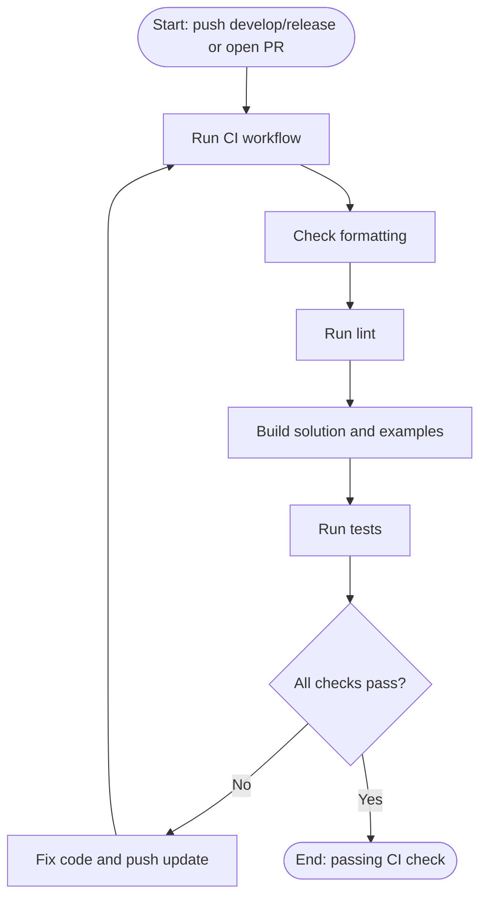
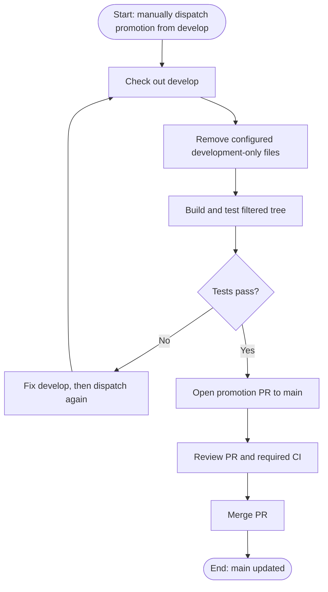
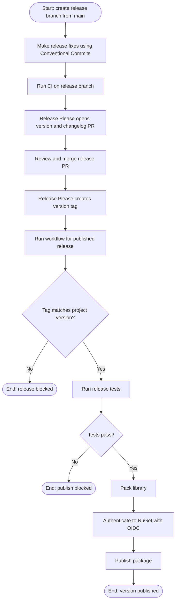

# CI/CD Checklist

This checklist moves StatePie toward a reliable, gated GitHub Actions pipeline. The intended flow is to keep
development-only files on `develop`, promote a filtered tree to `main`, stabilize each release on a protected
version-specific branch, and publish the commit identified by its version tag.

## 1. Add Continuous Integration

- [ ] Create `.github/workflows/ci.yml`.
    - **Where:** Add a separate workflow; do not turn the manual promotion workflow into the general CI workflow.
    - **When:** Run on pushes to `develop` and `release/**`, and pull requests targeting `main` or `release/**`.
    - **How:** Use `actions/checkout@v7` and `actions/setup-dotnet@v6` with .NET SDK `10.0.x`.
    - **What to run:** Run the whitespace and style/lint verification commands from `.vscode/tasks.json`, build
      `StatePie.sln` in Release configuration, and run `tests/StatePie.Tests.csproj`. Building the solution also checks
      the runnable examples.
    - **Why:** Every normal development change and proposed main change should get fast, repeatable feedback without
      requiring someone to dispatch promotion manually.
    - **Done when:** A push to `develop` and a test pull request to `main` each produce a visible successful Actions
      check.

### CI Run

## 2. Run CI on the Generated Promotion PR

- [ ] Make the promotion PR trigger the CI workflow.
    - **Where:** Update `.github/workflows/promote-to-main.yml`, specifically the token passed to
      `peter-evans/create-pull-request`.
    - **Current behavior:** The promotion workflow filters files and runs `dotnet test` before creating the PR. It uses
      `${{ github.token }}` to create that PR. GitHub suppresses new workflow runs caused by events from `GITHUB_TOKEN`,
      so a separate `pull_request` CI workflow will not run for that generated PR.
    - **How:** Prefer a narrowly permissioned GitHub App installation token; alternatively use a fine-grained PAT stored
      as a repository secret such as `PROMOTION_TOKEN`. Grant only the repository contents and pull-request permissions
      needed by the action, then pass that token to the action.
    - **Why:** The promotion workflow's pre-PR test is useful, but it does not create a check attached to the PR. The PR
      should receive the same CI result as other pull requests.
    - **Done when:** Dispatching promotion creates a PR and the CI workflow runs on that PR head.

## 3. Enforce the Main-Branch Gate

- [ ] Configure rules for `main` once repository visibility/plan supports enforcement.
    - **Where:** GitHub repository Settings, under Rulesets or Branch protection rules for the `main` branch.
    - **How:** Require pull requests, require the CI check from step 1, prohibit force pushes and branch deletion, and
      avoid broad bypass permissions.
    - **Why:** A passing check is only advisory until GitHub blocks merging when it is missing or failing.
    - **Important:** GitHub currently warns that rules are not enforced for this private repository on its current plan.
      Treat this step as pending until the repository is public or on a plan that enforces the rule; verify enforcement
      with a test PR afterward.
    - **Sync constraint:** The post-release job currently pushes tested merge commits directly to `main` and `develop`.
      A PR-required rule will block those pushes. Before enabling enforcement, change sync to create back-merge PRs with
      auto-merge after CI, or authorize a narrowly scoped GitHub App to perform only those sync updates; do not grant
      broad human bypass.
    - **Done when:** A PR cannot merge before CI passes, and direct pushes to `main` are rejected.

## 4. Keep Promotion Filtering Deliberate

- [ ] Maintain the explicit development-only file list in `.github/workflows/promote-to-main.yml`.
    - **Current policy:** Keep shared files such as `.gitignore`, `.editorconfig`, formatter config, and VS Code tasks
      in `main`; filter only files intentionally kept development-only, currently `.github/agents/`,
      `.vscode/settings.json`, `*.code-workspace`, and `ROADMAP.md`.
    - **How:** Review the filter whenever files are added or renamed. Test the filtered tree before opening the PR, and
      ensure cleanup/build steps cannot add generated `bin/` or `obj/` outputs to the promotion branch.
    - **Why:** Broad directory deletion can remove useful project configuration or create noisy promotion PRs.
    - **Done when:** A promotion PR contains only the intended source changes and explicitly filtered files, and its CI
      check is green.

### Promotion Run

## 5. Prepare Protected Release Branches and Tags

- [ ] Use a short-lived release branch for each release line, for example `release/0.2.x`.
    - **Where:** Create it from `main` after the filtered promotion PR has merged.
    - **How:** Allow only release fixes on this branch and run CI for every push and PR. Configure Release Please to
      target the active release branch. Merging its version PR creates the version tag and GitHub Release; the NuGet
      workflow validates, tests, packs, and publishes that tagged commit.
    - **Why:** The release branch is a stabilization lane. Releases do not automatically merge back into `main` or
      `develop`; those branches remain on their own promotion schedule.
    - **Done when:** The reviewed release PR produces a valid tag and package. Any integration into `main` or `develop`
      is a separate, deliberate PR.

- [ ] Protect release branches and version tags when repository rules can be enforced.
    - **Where:** Configure GitHub rulesets for `release/**` and `v*`.
    - **How:** Require PRs and CI for release branches; block tag updates and deletion. Apply these rules after the
      repository is public or on an eligible plan.
    - **Why:** A version tag must not silently move to different source after publication.
    - **Done when:** Direct release-branch pushes and tag rewrites/deletions are rejected.

## 6. Automate Version Bumps and Release Notes

- [ ] Configure Release Please to propose version-update PRs for .NET package releases.
    - **Where:** Add `release-please-config.json`, `.release-please-manifest.json`, and a release-please GitHub Actions
      workflow. Configure it to target the active `release/*` branch.
    - **How:** Use Release Please's `simple` strategy with Conventional Commit messages. Keep `version.txt` and
      `.release-please-manifest.json` initialized to the current `0.1.0-preview.1` version, generate `CHANGELOG.md`, and
      configure an XML extra-file updater for the `<Version>` element in `src/StatePie.csproj`. Release Please opens a
      PR with those updates; review and merge it to create the version tag and GitHub release. Use the same narrowly
      scoped `PROMOTION_TOKEN` as the promotion workflow so release PR/tag events can trigger downstream workflows.
    - **Why:** Version, changelog, project metadata, tag, and release notes are generated together. You review one
      release PR instead of manually editing version fields across files.
    - **Done when:** A `fix:` or `feat:` change on a release branch produces the expected patch/minor release PR,
      updates the project version and changelog, and creates the matching tag after merge.

- [ ] Make NuGet publishing consume Release Please tags.
    - **Where:** Update `.github/workflows/publish-to-nuget.yml`.
    - **How:** Trigger on `release: published` so Release Please releases and the GitHub **Create release** UI both
      start publishing. Read and validate the tag, test the release commit, pack only `src/StatePie.csproj`, and publish
      using the existing NuGet OIDC login. Keep `--skip-duplicate` disabled.
    - **Why:** The package version must match the reviewed release PR and immutable source tag, with no manual version
      entry at publish time.
    - **Done when:** Publishing a GitHub Release with a Release Please-generated tag validates and publishes exactly
      once; invalid versions or test failures stop publication.

## 7. Finish Trusted Publishing Setup

- [ ] Verify NuGet.org Trusted Publishing for the current release workflow.
    - **Where:** NuGet.org account settings for Trusted Publishing and GitHub repository Actions secrets/environments.
    - **How:** Configure the policy for owner `vancauter`, repository `state-pie.net`, workflow file
      `publish-to-nuget.yml`; verify `NUGET_USER` contains the NuGet profile username. The workflow already uses
      `NuGet/login@v1` with `id-token: write` and does not store a long-lived NuGet API key.
    - **Optional hardening:** Add a GitHub environment such as `nuget-production`, restrict it to `main`, and require
      approval before the publish job when the account plan supports environment protection.
    - **Why:** OIDC avoids storing a long-lived publishing credential, while an environment adds a deliberate approval
      point.
    - **Done when:** Publishing an approved `v*` GitHub Release runs tests, obtains a temporary NuGet API key, and
      publishes only after all version checks pass.

### Release Run

## 8. Maintain Workflow Supply-Chain Hygiene

- [ ] Pin third-party GitHub Actions to full commit SHAs and automate updates.
    - **Where:** All `uses:` entries under `.github/workflows/`.
    - **How:** Replace movable major tags with verified full commit SHAs and add `.github/dependabot.yml` updates for
      the `github-actions` and `nuget` ecosystems. Include the upstream action version in a comment beside each SHA.
    - **Why:** A tag can move; a SHA makes the exact action code used by a workflow reviewable and repeatable. Automated
      update PRs keep those pins maintainable.
    - **Done when:** Every third-party action is SHA-pinned and Dependabot opens update PRs for workflows and NuGet
      dependencies.

## 9. Add Automatically Updating Badges

- [ ] Add the applicable dynamic badges to the top of `README.md`.
    - **Where:** Place them immediately below the project description.
    - **How:** Add a GitHub Actions badge for the always-on CI workflow, a NuGet prerelease/version badge for
      `SC.StatePie`, and a license badge. Use badge endpoints that read current workflow/package/license state; don’t
      write a workflow that commits badge changes to the README on each release.
    - **Why:** Badge URLs are configured once, while their displayed status/version updates from the source service. The
      CI badge is meaningful only after the always-on CI workflow exists; use the prerelease NuGet badge while the
      latest package is prerelease.
    - **Done when:** Each badge links to its source (workflow, package page, or LICENSE), renders on GitHub, and updates
      without a README commit.

## Suggested Order

1. Add always-on CI for `develop` pushes and PRs to `main`.
2. Make generated promotion PRs trigger CI, then require the check on `main` when branch rules are enforceable.
3. Preserve the intentional promotion filter and keep development-only files on `develop`.
4. Configure main and release branch/tag rules when the account can enforce them.
5. Add protected release branches and configure Release Please to update the project version, changelog, and tag.
6. Trigger NuGet publishing from those tags, enforce monotonic versions, and verify Trusted Publishing.
7. Pin actions and enable Dependabot updates.
8. Add dynamic CI, NuGet, and license badges after their source workflows/package states are available.
